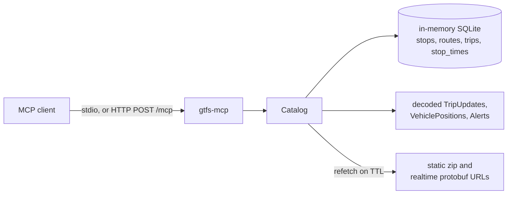

# gtfs-mcp

[](https://www.npmjs.com/package/gtfs-mcp)
[](https://crates.io/crates/gtfs-mcp)
[](https://docs.rs/gtfs-mcp)

MCP server that lets an agent read GTFS static schedules and GTFS-Realtime feeds. The API reference is on [docs.rs](https://docs.rs/gtfs-mcp). Register a feed, then ask where a vehicle is, how late it is, which track it was assigned, what the next departures are, and which alerts are active.

It works with any agency. Startup takes one static GTFS zip (URL or path) and optional TripUpdates, VehiclePositions, and Alerts protobufs. `register_feed` can add more feeds after the process is running.

gtfs-mcp is operator-agnostic: `src/` and `tests/` do not name an agency, embed a real feed endpoint or feed id, or special-case an auth flow. Examples use placeholders on reserved domains such as `example.com`, and CI rejects other GTFS URLs there.

## Install as an MCP server

Quick start, from npmjs.org:

```bash
npx -y gtfs-mcp --version
```

The launcher accepts the same arguments as the binary. Serving MCP needs a transport subcommand: `stdio` or `http`. `npx -y gtfs-mcp` with no subcommand exits, because that subcommand is required.

```bash
GTFS_MCP_STATIC=https://example.com/gtfs.zip npx -y gtfs-mcp stdio
```

`GTFS_MCP_STATIC` is required. The other feed variables are optional. Every URL below is a placeholder on `example.com`. `GTFS_MCP_HTTP_HEADERS` is a JSON object of header name to string value. The value `replace-me` is not a real token.

| Variable | Required | Meaning |
| --- | --- | --- |
| `GTFS_MCP_STATIC` | yes | GTFS static zip URL or path. |
| `GTFS_MCP_TRIP_UPDATES` | no | TripUpdates protobuf URL or path. |
| `GTFS_MCP_VEHICLE_POSITIONS` | no | VehiclePositions protobuf URL or path. |
| `GTFS_MCP_ALERTS` | no | Alerts protobuf URL or path. |
| `GTFS_MCP_HTTP_HEADERS` | no | JSON object of HTTP headers. Values are never logged. |

`stdio` speaks MCP on stdin and stdout. Logs go to stderr. Put `stdio` in the client's `args` (or after `--` in Claude Code). The server name is `gtfs-mcp`.

### Claude Desktop

`claude_desktop_config.json` (`~/Library/Application Support/Claude/claude_desktop_config.json` on macOS, `%APPDATA%\Claude\claude_desktop_config.json` on Windows):

```json
{
  "mcpServers": {
    "gtfs-mcp": {
      "command": "npx",
      "args": ["-y", "gtfs-mcp", "stdio"],
      "env": {
        "GTFS_MCP_STATIC": "https://example.com/gtfs.zip",
        "GTFS_MCP_TRIP_UPDATES": "https://example.com/realtime/trip-updates.pb",
        "GTFS_MCP_VEHICLE_POSITIONS": "https://example.com/realtime/vehicle-positions.pb",
        "GTFS_MCP_ALERTS": "https://example.com/realtime/alerts.pb",
        "GTFS_MCP_HTTP_HEADERS": "{\"x-api-key\":\"replace-me\"}"
      }
    }
  }
}
```

### Claude Code

`-e` is the short form of `--env`. The server name comes before `-e`, and `stdio` comes after `--`:

```bash
claude mcp add gtfs-mcp \
  -e GTFS_MCP_STATIC=https://example.com/gtfs.zip \
  -e GTFS_MCP_TRIP_UPDATES=https://example.com/realtime/trip-updates.pb \
  -e GTFS_MCP_VEHICLE_POSITIONS=https://example.com/realtime/vehicle-positions.pb \
  -e GTFS_MCP_ALERTS=https://example.com/realtime/alerts.pb \
  -e 'GTFS_MCP_HTTP_HEADERS={"x-api-key":"replace-me"}' \
  -- npx -y gtfs-mcp stdio
```

The same shape with only the required variable:

```bash
claude mcp add gtfs-mcp -e GTFS_MCP_STATIC=https://example.com/gtfs.zip -- npx -y gtfs-mcp stdio
```

### Cursor

`.cursor/mcp.json` in the project, or `~/.cursor/mcp.json` for every project:

```json
{
  "mcpServers": {
    "gtfs-mcp": {
      "command": "npx",
      "args": ["-y", "gtfs-mcp", "stdio"],
      "env": {
        "GTFS_MCP_STATIC": "https://example.com/gtfs.zip",
        "GTFS_MCP_TRIP_UPDATES": "https://example.com/realtime/trip-updates.pb",
        "GTFS_MCP_VEHICLE_POSITIONS": "https://example.com/realtime/vehicle-positions.pb",
        "GTFS_MCP_ALERTS": "https://example.com/realtime/alerts.pb",
        "GTFS_MCP_HTTP_HEADERS": "{\"x-api-key\":\"replace-me\"}"
      }
    }
  }
}
```

### VS Code

`.vscode/mcp.json` uses `servers`, and a stdio server sets `"type": "stdio"`:

```json
{
  "servers": {
    "gtfs-mcp": {
      "type": "stdio",
      "command": "npx",
      "args": ["-y", "gtfs-mcp", "stdio"],
      "env": {
        "GTFS_MCP_STATIC": "https://example.com/gtfs.zip",
        "GTFS_MCP_TRIP_UPDATES": "https://example.com/realtime/trip-updates.pb",
        "GTFS_MCP_VEHICLE_POSITIONS": "https://example.com/realtime/vehicle-positions.pb",
        "GTFS_MCP_ALERTS": "https://example.com/realtime/alerts.pb",
        "GTFS_MCP_HTTP_HEADERS": "{\"x-api-key\":\"replace-me\"}"
      }
    }
  }
}
```

### Windsurf

`~/.codeium/windsurf/mcp_config.json`:

```json
{
  "mcpServers": {
    "gtfs-mcp": {
      "command": "npx",
      "args": ["-y", "gtfs-mcp", "stdio"],
      "env": {
        "GTFS_MCP_STATIC": "https://example.com/gtfs.zip",
        "GTFS_MCP_TRIP_UPDATES": "https://example.com/realtime/trip-updates.pb",
        "GTFS_MCP_VEHICLE_POSITIONS": "https://example.com/realtime/vehicle-positions.pb",
        "GTFS_MCP_ALERTS": "https://example.com/realtime/alerts.pb",
        "GTFS_MCP_HTTP_HEADERS": "{\"x-api-key\":\"replace-me\"}"
      }
    }
  }
}
```

### Codex CLI

`~/.codex/config.toml` (or `.codex/config.toml` in the project):

```toml
[mcp_servers.gtfs-mcp]
command = "npx"
args = ["-y", "gtfs-mcp", "stdio"]

[mcp_servers.gtfs-mcp.env]
GTFS_MCP_STATIC = "https://example.com/gtfs.zip"
GTFS_MCP_TRIP_UPDATES = "https://example.com/realtime/trip-updates.pb"
GTFS_MCP_VEHICLE_POSITIONS = "https://example.com/realtime/vehicle-positions.pb"
GTFS_MCP_ALERTS = "https://example.com/realtime/alerts.pb"
GTFS_MCP_HTTP_HEADERS = '{"x-api-key":"replace-me"}'
```

### Streamable HTTP

`http` listens on `127.0.0.1:8091` by default. MCP is `http://127.0.0.1:8091/mcp`. Liveness is `GET /healthz`. The feed variables belong on this process, not on the client URL. `Host` must be `localhost`, `127.0.0.1`, or `::1` unless you pass `--allowed-host` (`GTFS_MCP_ALLOWED_HOST`). `--bind` (`GTFS_MCP_BIND`) changes the listen address.

```bash
GTFS_MCP_STATIC=https://example.com/gtfs.zip \
GTFS_MCP_TRIP_UPDATES=https://example.com/realtime/trip-updates.pb \
GTFS_MCP_VEHICLE_POSITIONS=https://example.com/realtime/vehicle-positions.pb \
GTFS_MCP_ALERTS=https://example.com/realtime/alerts.pb \
GTFS_MCP_HTTP_HEADERS='{"x-api-key":"replace-me"}' \
npx -y gtfs-mcp http
```

Claude Desktop and Cursor:

```json
{
  "mcpServers": {
    "gtfs-mcp": {
      "url": "http://127.0.0.1:8091/mcp"
    }
  }
}
```

Claude Code:

```bash
claude mcp add --transport http gtfs-mcp http://127.0.0.1:8091/mcp
```

VS Code `.vscode/mcp.json`:

```json
{
  "servers": {
    "gtfs-mcp": {
      "type": "http",
      "url": "http://127.0.0.1:8091/mcp"
    }
  }
}
```

Windsurf uses `serverUrl`:

```json
{
  "mcpServers": {
    "gtfs-mcp": {
      "serverUrl": "http://127.0.0.1:8091/mcp"
    }
  }
}
```

Codex CLI:

```toml
[mcp_servers.gtfs-mcp]
url = "http://127.0.0.1:8091/mcp"
```

### Other ways to install

`cargo install` needs Rust 1.88 or newer. A system `protoc` is not required.

```bash
cargo install gtfs-mcp --locked
```

GitHub Releases for tag `vX.Y.Z` ship linux x86_64 and aarch64 (musl), macOS x86_64 and aarch64, and Windows x86_64, plus `sha256sums.txt`.

```bash
curl --proto '=https' --tlsv1.2 -fsSL \
  https://github.com/sohampatwardhan/gtfs-mcp/releases/latest/download/gtfs-mcp-installer.sh | sh
```

```powershell
irm https://github.com/sohampatwardhan/gtfs-mcp/releases/latest/download/gtfs-mcp-installer.ps1 | iex
```

The installers are `scripts/install.sh` and `scripts/install.ps1`. `GTFS_MCP_VERSION=0.3.0` selects a release. `PREFIX` sets the install directory (the default is `~/.local` on Unix and `%LOCALAPPDATA%\gtfs-mcp` on Windows). A Homebrew tap is not part of this release.

`GTFS_MCP_BINARY` is a path to a local `gtfs-mcp` binary. The npm launcher skips its download when that variable is set. `HTTPS_PROXY` (or `https_proxy`, then `HTTP_PROXY`) is honored. `NO_PROXY` skips the proxy for matching hosts.

The npm package has no install scripts, so `npx --ignore-scripts` still works. On first run it downloads the archive for its own version from GitHub Releases, checks `sha256sums.txt`, and caches the binary. Later runs use the cache.

The same launcher is also published as `@sohampatwardhan/gtfs-mcp` on GitHub Packages. `npx -y gtfs-mcp` on npmjs.org stays the usual install. To use the scoped package, point the scope at GitHub Packages in `.npmrc`. That registry needs a GitHub token with `read:packages`:

```text
@sohampatwardhan:registry=https://npm.pkg.github.com
//npm.pkg.github.com/:_authToken=YOUR_GITHUB_TOKEN
```

```bash
npx -y @sohampatwardhan/gtfs-mcp --version
```

## Why Rust

The server is Rust because that fits a long-running agent tool:

- The official Rust MCP SDK (`rmcp`) speaks stdio and streamable HTTP, and `prost` decodes GTFS-Realtime protobufs.
- Static GTFS lands in an in-memory SQLite database (bundled, so the host does not need a system SQLite). Realtime messages stay decoded in memory and refresh on a TTL.
- One binary, about 9.4 MB stripped, links only glibc, libm, and libgcc. No JVM and no Python runtime.
- Python is a reasonable language for a one-shot script, and the GTFS libraries are convenient, but a resident interpreter plus protobuf and HTTP stacks is a larger and less predictable process.
- Java can host GTFS libraries, and it pays for that with a JVM that is large next to this binary.
- Swift is a good fit on macOS and less so for a small Linux MCP server with stdio and streamable HTTP.

The same crate builds on linux/arm64 and macOS. Release builds use thin LTO, `opt-level = "z"`, and stripped symbols.

## Architecture



Static GTFS is parsed into SQLite. Direct agency URLs are mutable, so the static zip is fetched again when its TTL elapses (`GTFS_MCP_STATIC_TTL`, default 6 hours, `0` disables the timer) and the realtime protobufs are fetched again when `GTFS_MCP_RT_TTL` elapses (default 15 seconds). `refresh_feed` fetches them immediately. A failed refresh keeps the last good copy and records `last_error` on `feed_health`.

## Build

Rust 1.88 or newer. The VM used for development was rustc 1.99.

Debian, Ubuntu, or Raspberry Pi OS:

```bash
sudo apt-get update
sudo apt-get install -y build-essential pkg-config
curl --proto '=https' --tlsv1.2 -sSf https://sh.rustup.rs | sh
cargo build --release --locked
./target/release/gtfs-mcp --version
```

macOS:

```bash
cargo build --release --locked
```

`protoc` is not a system package. `build.rs` uses `protoc-bin-vendored`. The GTFS-Realtime schema is vendored in `proto/gtfs-realtime.proto` (Apache-2.0, from the MobilityData GTFS-Realtime spec).

## Breaking changes in 0.2.0

0.2.0 renamed the project from `gtfs-rt-mcp` to `gtfs-mcp`. Environment variables use the `GTFS_MCP_` prefix. The old `GTFS_RT_MCP_*` names are not accepted. 0.3.0 is the current release.

Startup configuration is one feed, and `GTFS_MCP_STATIC` (or `--static`) is required. These 0.1.0 options are gone:

- `GTFS_MCP_FEED_SET` and `--feed-set`
- `GTFS_MCP_FEED_<n>_*` numbered feeds
- `GTFS_MCP_FEEDS` JSON
- the `feed_set` field on `register_feed`

If `GTFS_MCP_STATIC` is missing or empty, the process exits with status 1. A malformed optional value (bad TTL, TTL out of range, or HTTP headers that are not a JSON object of strings) also exits with status 1 before the server listens. Header values are never written to that error. A static location that is set but cannot be read is reported on stderr and as a feed with `"ready": false`; the process still starts so `register_feed` can replace it.

## Run

Logs go to stderr. stdio mode must not print on stdout. The usual way to configure the feed is the `env` block of an MCP client (see below). The same variables work in a shell. The URLs below are placeholders on the reserved `example.com` domain.

```bash
GTFS_MCP_FEED_ID=harbor \
GTFS_MCP_STATIC=https://example.com/gtfs.zip \
GTFS_MCP_TRIP_UPDATES=https://example.com/realtime/trip-updates.pb \
GTFS_MCP_VEHICLE_POSITIONS=https://example.com/realtime/vehicle-positions.pb \
GTFS_MCP_ALERTS=https://example.com/realtime/alerts.pb \
GTFS_MCP_HTTP_HEADERS='{"Authorization":"Bearer replace-me"}' \
gtfs-mcp stdio

# The same fields as flags. A flag overrides the matching variable.
gtfs-mcp --feed-id harbor --static https://example.com/gtfs.zip stdio

# Streamable HTTP on 127.0.0.1:8091, MCP at /mcp, liveness at /healthz.
GTFS_MCP_STATIC=https://example.com/gtfs.zip gtfs-mcp http
```

There are no built-in credentials. Header values are sent on fetch and are never written to logs or tool results. `feed_health` and `list_feeds` return header names only.

HTTP accepts `Host: localhost`, `127.0.0.1`, and `::1` by default. Add `--allowed-host your-pi.local` when a non-loopback client connects. `GTFS_MCP_BIND` sets the listen address (default `127.0.0.1:8091`). `GTFS_MCP_ALLOWED_HOST` may be repeated. `GTFS_MCP_LOG` or `RUST_LOG` sets the stderr tracing filter.

## Configuration

Empty values are ignored. `http://` and `https://` are URLs; anything else is a filesystem path. `--feed-id`, `--static`, `--trip-updates`, `--vehicle-positions`, `--alerts`, `--rt-ttl`, `--static-ttl`, and `--http-headers` override the matching variable.

The feed variables come first. `GTFS_MCP_STATIC` is required.

| Variable | Required | Meaning |
| --- | --- | --- |
| `GTFS_MCP_STATIC` | yes | GTFS static zip URL or path. |
| `GTFS_MCP_TRIP_UPDATES` | no | TripUpdates protobuf URL or path. |
| `GTFS_MCP_VEHICLE_POSITIONS` | no | VehiclePositions protobuf URL or path. |
| `GTFS_MCP_ALERTS` | no | Alerts protobuf URL or path. |

Optional extras and server settings:

| Variable | Meaning |
| --- | --- |
| `GTFS_MCP_HTTP_HEADERS` | JSON object of header name to string value, for example `{"x-api-key":"replace-me"}`. Values are never logged or echoed. |
| `GTFS_MCP_FEED_ID` | Feed id. Default `default`. Letters, numbers, and `_` `.` `:` `-`, 1–64 characters. |
| `GTFS_MCP_RT_TTL` | Realtime TTL in seconds. Integer 1–3600. Default 15. |
| `GTFS_MCP_STATIC_TTL` | Static-zip TTL in seconds. `0` disables the timer. Max 604800. Default 21600. |
| `GTFS_MCP_BIND` | HTTP listen address. Default `127.0.0.1:8091`. |
| `GTFS_MCP_ALLOWED_HOST` | Extra `Host` header to allow. May be repeated. |
| `GTFS_MCP_LOG` or `RUST_LOG` | stderr tracing filter. |

Missing or empty `GTFS_MCP_STATIC` exits with status 1 and names the variable, for example:

```text
gtfs-mcp: GTFS_MCP_STATIC is required (or pass --static). Example: GTFS_MCP_STATIC=https://example.com/gtfs.zip
```

Malformed optional values also exit with status 1 before the server listens. That includes a TTL that is not an integer, a TTL outside the range above, a feed id with characters outside the set above, and `GTFS_MCP_HTTP_HEADERS` that is not a JSON object of strings. The error names the variable. Header values are not included. A static zip or protobuf that is configured but fails to download does not exit: the feed is listed with `"ready": false`, and `register_feed` or `refresh_feed` can try again.

Startup registers one feed. `register_feed` can add further feeds at runtime, up to 16 total.

## Authentication

The server does not log in. It never exchanges a username and password for a token. What it can do today is send extra HTTP headers, or GET a URL that already contains a query string.

Open feeds need nothing. Leave `GTFS_MCP_HTTP_HEADERS` unset and use the feed URLs as published.

Feeds that expect an API key in a header use one JSON object of header name to string value. The name and value below are placeholders.

```bash
GTFS_MCP_STATIC=https://example.com/gtfs.zip \
GTFS_MCP_TRIP_UPDATES=https://example.com/realtime/trip-updates.pb \
GTFS_MCP_HTTP_HEADERS='{"x-api-key":"replace-me"}' \
gtfs-mcp stdio
```

The same object in an MCP client `env` block is a JSON string:

```json
"GTFS_MCP_HTTP_HEADERS": "{\"x-api-key\":\"replace-me\"}"
```

`--http-headers` overrides that variable for the startup feed. The same variable works in the environment of `gtfs-mcp http` or `npx -y gtfs-mcp`.

That header map belongs to the one startup feed. Every HTTP download for that feed sends it: the static zip and each realtime protobuf that is configured. Filesystem paths ignore it. The same map is sent again when a TTL refresh or `refresh_feed` downloads those URLs. One feed cannot use a different header map per URL.

`register_feed` does not read `GTFS_MCP_HTTP_HEADERS`. Pass `headers` on that call. Those headers are stored on that `feed_id` only, and they replace any headers already stored if the same id is registered again. Omitting `headers` stores an empty map. `decode_protobuf` takes its own `headers` for that single URL and does not register them.

A feed that expects the key in the query string is just a URL. Put the placeholder in the URL you already pass:

```text
https://example.com/gtfs.zip?api_key=replace-me
```

The server GETs that string as given. It does not strip the query. The full URL, including the query, is returned in `feed_health` and `list_feeds` under `source`, and a failed download prints `GET <url>` on stderr. Prefer a header when the publisher allows either form.

Keep keys in the MCP client's env or secret store, or in the environment of the process that starts `gtfs-mcp`. Do not commit them. Header values are not written to logs or tool results. `feed_health` and `list_feeds` return header names only. If a startup load error would otherwise include a header value of 4 or more characters, that value is replaced with `[redacted]`.

## MCP clients

Copy-paste configs are under [Install as an MCP server](#install-as-an-mcp-server). When the client starts the process, `args` must include `stdio`. The feed in `env` is registered before the first tool call, so the model does not need `register_feed` for that feed. Further feeds are added at runtime with `register_feed`.

The server name is `gtfs-mcp`. Instructions on `initialize` tell the model to call `list_feeds` first. Responses are compact JSON. Page with `offset` until `next_offset` is null.

## Tools

| Tool | What it answers |
| --- | --- |
| `register_feed` | Load another static zip plus optional realtime URLs. Replaces the same `feed_id`, including a startup row that failed. |
| `list_feeds` | Registered feeds and `ready`. Header names only. |
| `unregister_feed` | Drop a feed and its caches. |
| `refresh_feed` | Re-read the static zip and realtime protobufs now. Retries a feed that failed at startup. |
| `feed_health` | Counts, header timestamps, age, TTL, and last error. |
| `search_stops` | `stop_id`, code, or name. Default 20, max 100. |
| `search_routes` | `route_id`, short name, or long name. |
| `trip_status` | Where a trip is. `trip` is a `trip_id` or `trip_short_name` (train number). Optional `stop` fills delay and track. |
| `trip_schedule` | Stop sequence with scheduled and estimated times. |
| `departure_board` | Station board: static schedule plus realtime delay, cancellation, and track. |
| `vehicle_positions` | Live positions. Filter by route, trip, vehicle, or stop. |
| `trip_updates` | Delays and `assigned_stop_id`. A stop filter matches `stop_id` or the static stop at that `stop_sequence`. |
| `alerts` | Cause, effect, severity, periods, informed entities, and clipped text. |
| `decode_protobuf` | One FeedMessage from a path, http(s) URL, or base64 string. Does not register a feed. |

`feed_id` may be omitted when one feed is registered. `at_unix` pins the clock; omit it to use the current time. Delays are seconds, and positive means late. `track` is the static `platform_code` of `assigned_stop_id` when that stop exists, otherwise the scheduled platform.

Limits: list tools default to 20 rows and cap at 100. `trip_updates` keeps 8 stop updates per trip (max 40). Alert text defaults to 400 characters (max 2000). `decode_protobuf` returns 20 entities (max 100).

Up to 16 feeds can be registered. Realtime TTL defaults to 15 seconds (1–3600). Static zips refresh every 6 hours unless `static_ttl_secs` is `0`. Downloads are capped at 250 MB for a static zip and 80 MB for a realtime message.

## Realtime fields

`http://` and `https://` locations are fetched as written. Anything else is a filesystem path. A `file://` URL is a local path.

Track assignments follow the usual GTFS-Realtime convention: `stop_time_properties.assigned_stop_id` such as `NHV:track:12`, often with `stop_sequence` set and `stop_id` omitted. Static GTFS can carry a parent station and platform stops whose `platform_code` is the track label. Stop updates match `stop_sequence` first, then `stop_id`. A delay carries forward from the previous stop until the next update; `NO_DATA`, `SKIPPED`, and an assigned platform do not. An absolute `time` wins over `delay`.

## Example: Harbor fixture

The checked-in Harbor Line fixture is a small static zip plus three protobufs, with no network. Clock is 2026-01-15 11:30 America/New_York (`at_unix` 1768494600). Train 177 (`trip_short_name`) is the Northeast Corridor trip `177-BOS`, in transit to New Haven.

`trip_status` with `trip: "177"`, `stop: "NHV"`, `at_unix: 1768494600` returns, in part:

```json
{
  "trip_id": "177-BOS",
  "trip_short_name": "177",
  "route_short_name": "NEC",
  "delay_sec": 480,
  "delay_label": "8 min late",
  "vehicle": {
    "status": "IN_TRANSIT_TO",
    "stop_id": "NHV",
    "lat": 41.25,
    "lon": -72.95,
    "vehicle": { "label": "177" }
  },
  "at_stop": {
    "stop_id": "NHV",
    "scheduled_departure_local": "12:04",
    "estimated_departure_local": "12:12",
    "arrival_delay_sec": 420,
    "departure_delay_sec": 480,
    "assigned_stop_id": "NHV:track:12",
    "platform_code": "12",
    "track": "12"
  }
}
```

`departure_board` at New Haven for the next 120 minutes, ignoring anything that left more than 5 minutes ago, returns train 177 on track 12 at 12:12, then bus B1 at 12:30. Train 66 left at 11:15, so it is outside the window. Asking for the platform stop `NHV:track:12` still shows 177, because the board expands to the parent station and sibling platforms.

`alerts` with `route: "NEC"` returns one alert, header `Track work between NYP and NHV`, effect `SIGNIFICANT_DELAYS`. A local-bus detour in the same feed does not match.

`decode_protobuf` on `trip-updates.pb` shows the second stop update's `assigned_stop_id` of `NHV:track:12`.

## Example: a large agency feed

A previous run pointed `GTFS_MCP_STATIC` and the three realtime variables at a large public agency (no API key). The static feed was Fall 2026 (`10,292` stops, `3,104,937` stop times, `117,449` trips) in `America/New_York`. At fetch time the vehicle feed had 349 entities and was 1 second old; trip updates had 1,184 entities.

`search_stops` for `South Station` ranked the station `place-sstat` first.

`departure_board` at that station, `window_minutes: 90`, `limit: 5`, expanded 25 platforms (not pathway nodes) and returned 83 departures. The first page started with a Providence/Stoughton train, a Red Line trip, and two Silver Line trips.

`vehicle_positions` with `limit: 3` included a bus `IN_TRANSIT_TO` a stop, occupancy `MANY_SEATS_AVAILABLE`.

`alerts` with `active_only: true` and `limit: 3` returned 3 of 97.

Re-run that kind of check locally by substituting the agency's URLs (the values below are placeholders):

```bash
GTFS_MCP_STATIC=https://example.com/gtfs.zip \
GTFS_MCP_TRIP_UPDATES=https://example.com/realtime/trip-updates.pb \
GTFS_MCP_VEHICLE_POSITIONS=https://example.com/realtime/vehicle-positions.pb \
GTFS_MCP_ALERTS=https://example.com/realtime/alerts.pb \
cargo test --test live_feed -- --nocapture
```

The test skips when `GTFS_MCP_STATIC` is unset. CI does not set it. `cargo test` otherwise uses the Harbor fixture and loopback HTTP only.

## Tests and CI

```bash
cargo test --locked
```

GitHub Actions (`.github/workflows/ci.yml`) rejects non-reserved GTFS URLs in `src/` and `tests/`, checks that the npm package version matches `Cargo.toml`, runs `cargo fmt`, clippy, and `cargo test --locked`, and runs `cargo publish --dry-run --locked`. A system `protoc` is not installed. Tag `vX.Y.Z` runs `.github/workflows/release.yml`, which publishes the crate, release binaries, and the npm package. Version numbers change only through `scripts/bump-version.sh`.

## Layout

- `src/mcp.rs` — tool schemas and stdio / streamable HTTP serving
- `src/config.rs` — startup feed registration from environment variables and flags
- `src/catalog.rs` — feed registry, TTL refresh, last-good cache
- `src/gtfs.rs` — static zip to in-memory SQLite
- `src/realtime.rs` — protobuf decode, delay labels, platform fields
- `src/query.rs` — trip status, boards, vehicles, alerts
- `src/source.rs` — capped downloads of a static zip and realtime protobufs
- `tests/fixtures/harbor/` — tiny GTFS text files
- `proto/gtfs-realtime.proto` — vendored spec, Apache-2.0
- `.github/scripts/check-gtfs-urls.sh` — fails CI on a hardcoded GTFS endpoint
- `.github/workflows/release.yml` — tag-triggered publish
- `scripts/bump-version.sh` — bumps `Cargo.toml` and the npm package, then commits and tags
- `npm/gtfs-mcp/` — `npx` launcher that downloads a release binary
